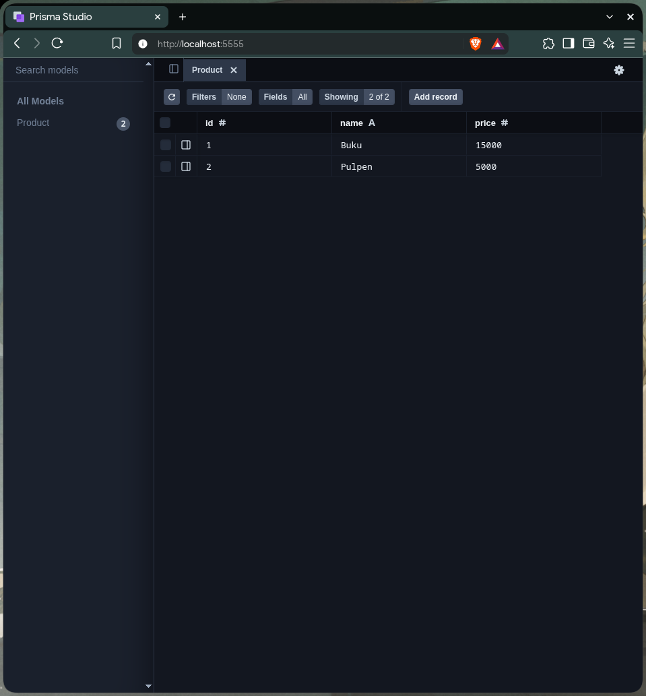
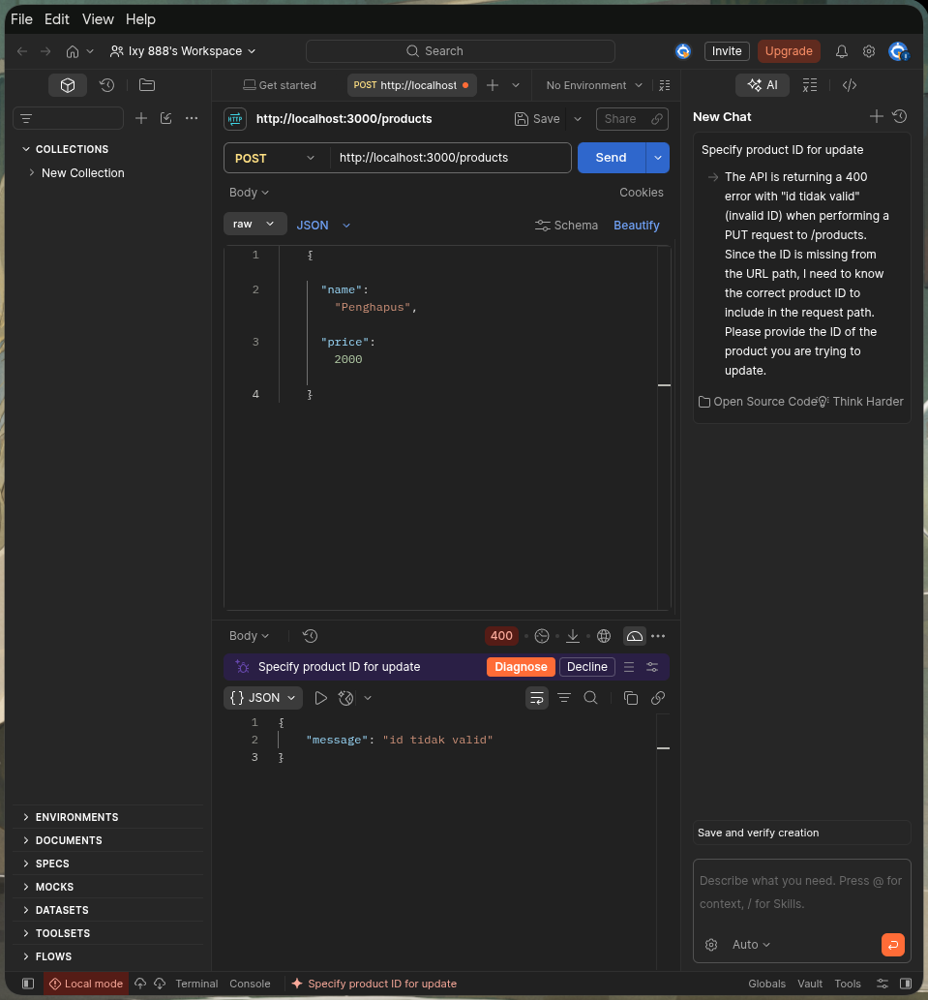
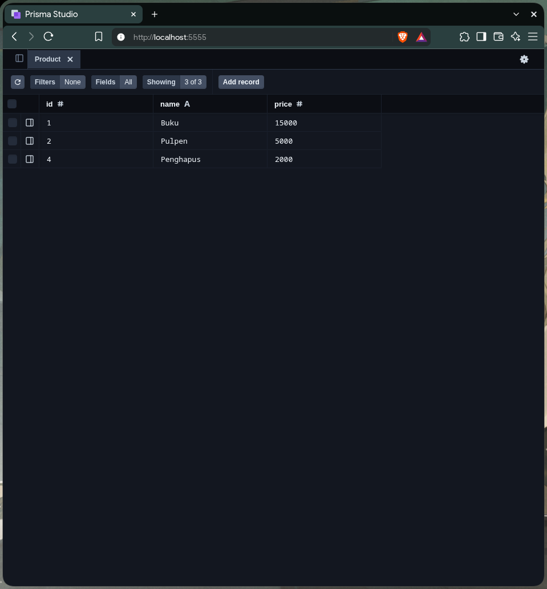
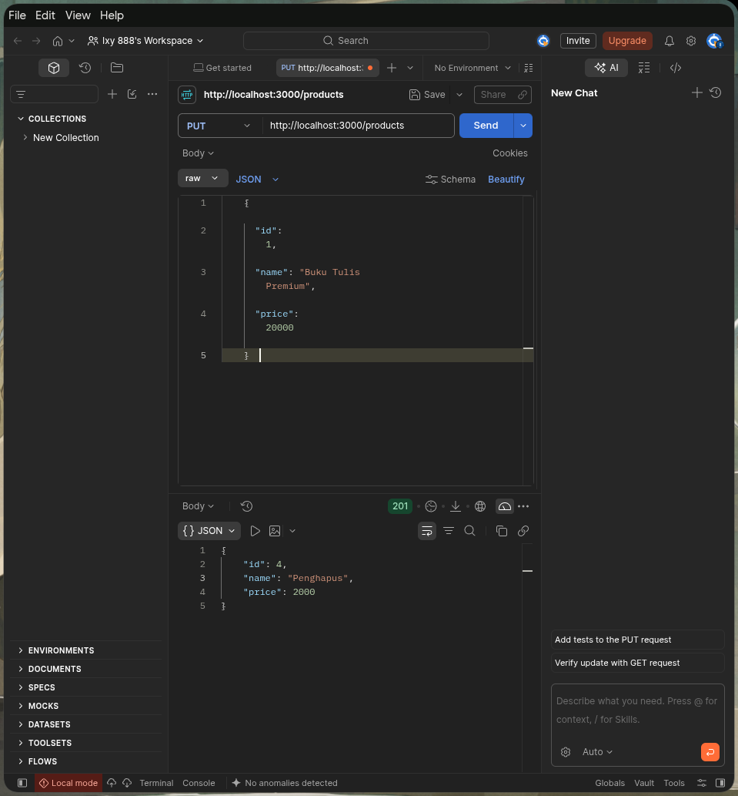
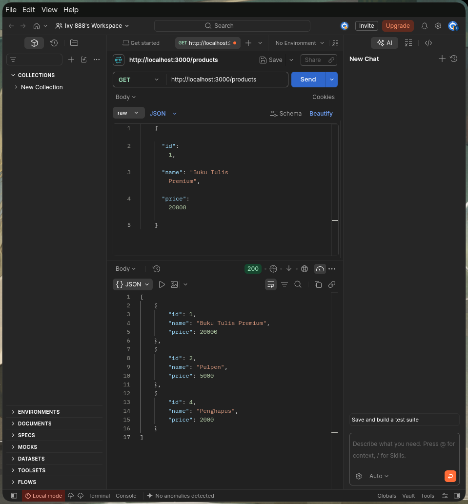
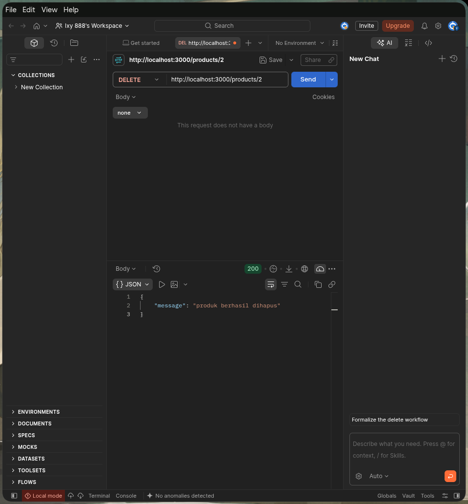
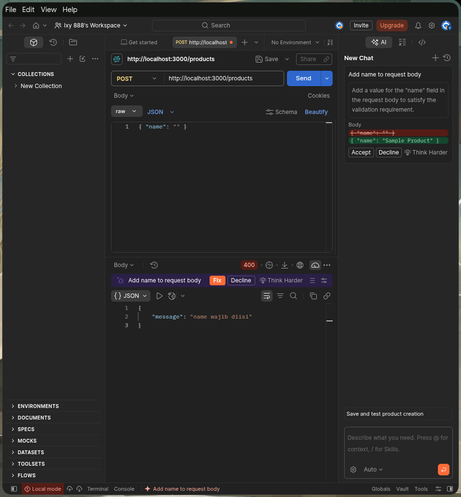
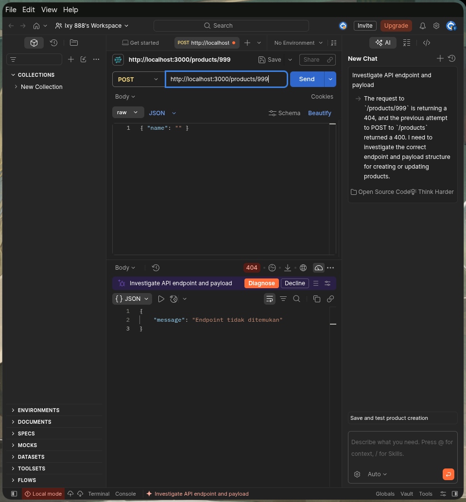

# ExpressJS Product REST API with Prisma ORM

REST API sederhana untuk manajemen produk yang dibangun menggunakan **Express.js**, **Prisma ORM**, dan database **SQLite**.

---

## 📁 Struktur Proyek

```text
chall_expressjs/
├── controllers/
│   └── productController.js   # Logika CRUD dan validasi dengan Prisma
├── prisma/
│   ├── migrations/            # Histori migrasi database
│   ├── schema.prisma          # Definisi model Product dan database SQLite
│   └── seed.js                # Data awal (seeder) database
├── routes/
│   └── productRoutes.js       # Definisi rute API produk (GET, POST, PUT, DELETE)
├── screenshot/                # Bukti hasil pengujian API & Database
├── app.js                     # Entry point server Express
├── package.json               # Konfigurasi dependensi dan scripts
├── .env.example               # Contoh variabel lingkungan
└── README.md                  # Dokumentasi proyek
```

---

## 🚀 Petunjuk Menjalankan

1. **Instal dependensi:**
   ```bash
   npm install
   ```

2. **Jalankan migrasi database & seeding awal:**
   ```bash
   npm run db:migrate
   ```

3. **Jalankan server:**
   - Mode standar:
     ```bash
     npm start
     ```
   - Mode development (auto-reload):
     ```bash
     npm run dev
     ```
   Server aktif pada: `http://localhost:3000`

4. **Membuka Prisma Studio (Database GUI Visual):**
   ```bash
   npm run studio
   ```
   Buka browser pada alamat: `http://localhost:5555`

---

## 📌 Daftar Endpoint API

| Method | Endpoint | Body Request | Status Code | Deskripsi |
| :--- | :--- | :--- | :--- | :--- |
| **GET** | `/products` | - | `200 OK` | Mengambil seluruh data produk |
| **GET** | `/products/:id` | - | `200 OK` / `404 Not Found` | Mengambil detail produk berdasarkan ID |
| **POST** | `/products` | `{ "name": "string", "price": number }` | `201 Created` / `400 Bad Request` | Menambahkan produk baru |
| **PUT** | `/products` | `{ "id": number, "name": "string", "price": number }` | `200 OK` / `400 Bad Request` / `404 Not Found` | Memperbarui produk yang sudah ada |
| **DELETE** | `/products/:id` | - | `200 OK` / `400 Bad Request` / `404 Not Found` | Menghapus produk berdasarkan ID |

---

## 🧪 Contoh Pengujian (cURL)

### 1. GET Semua Produk
```bash
curl -i http://localhost:3000/products
```

### 2. GET Produk Berdasarkan ID
```bash
curl -i http://localhost:3000/products/1
```

### 3. POST Tambah Produk Baru
```bash
curl -i -X POST http://localhost:3000/products \
  -H "Content-Type: application/json" \
  -d '{"name": "Penghapus", "price": 2000}'
```

### 4. PUT Update Produk (Body dengan ID)
```bash
curl -i -X PUT http://localhost:3000/products \
  -H "Content-Type: application/json" \
  -d '{"id": 1, "name": "Buku Tulis Premium", "price": 20000}'
```

### 5. DELETE Hapus Produk
```bash
curl -i -X DELETE http://localhost:3000/products/2
```

### 6. Skenario Validasi Error (400 Bad Request)
```bash
curl -i -X POST http://localhost:3000/products \
  -H "Content-Type: application/json" \
  -d '{"name": "", "price": -500}'
```

---

## 📸 Laporan Evidence (Hasil Pengujian)

### 1. Skenario POST (Tambah Data)
- **Database Sebelum POST (Prisma Studio):**
  
- **Request POST di Postman (201 Created):**
  
- **Database Sesudah POST (Prisma Studio - Data Bertambah):**
  

---

### 2. Skenario PUT (Update Data)
- **Request PUT di Postman (200 OK):**
  
- **Database Sesudah PUT (Prisma Studio - Data Terupdate):**
  

---

### 3. Skenario GET (Tampilkan Seluruh Data)
- **Request GET All di Postman (200 OK):**
  

---

### 4. Skenario DELETE (Hapus Data)
- **Request DELETE di Postman (200 OK):**
  
- **Database Sesudah DELETE (Prisma Studio - Data Terhapus):**
  

---

### 5. Skenario Validasi Error & Not Found
- **Kesalahan Validasi Input (400 Bad Request):**
  
- **Endpoint / Data Tidak Ditemukan (404 Not Found):**
  
