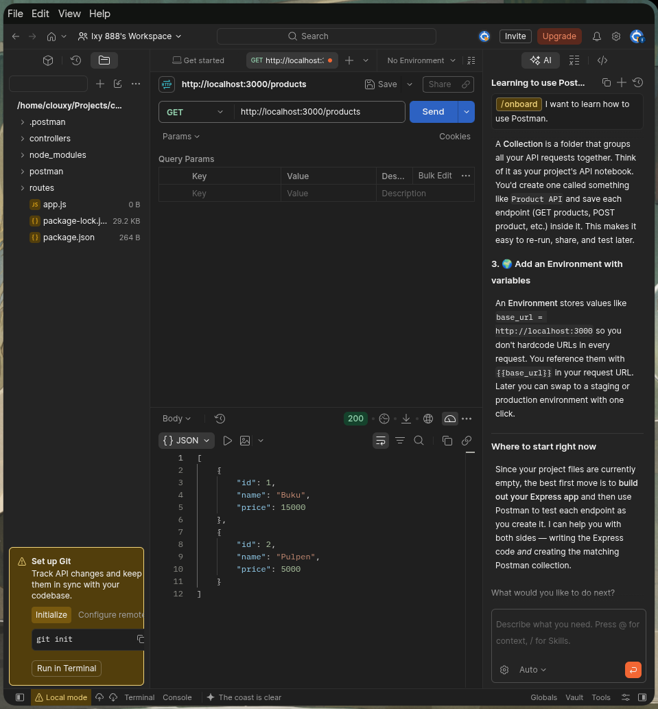
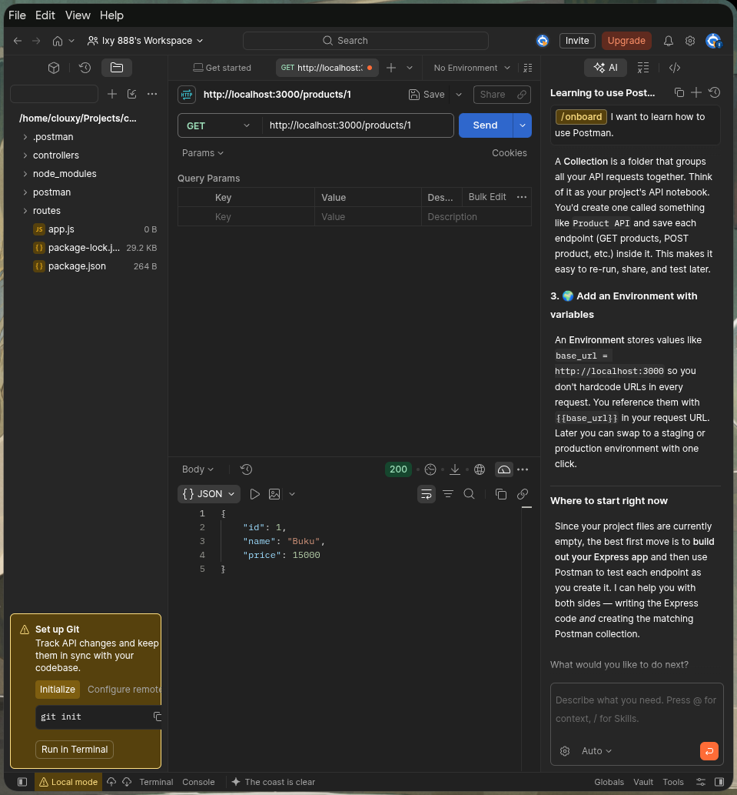
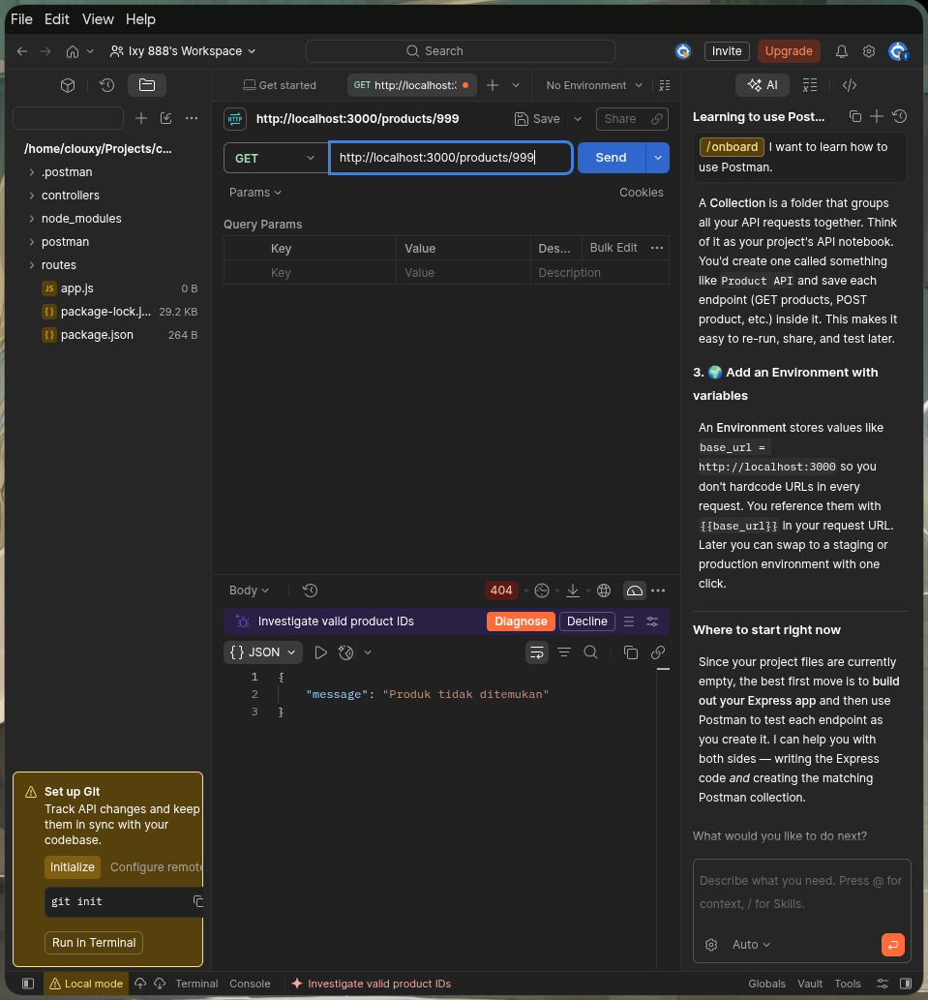
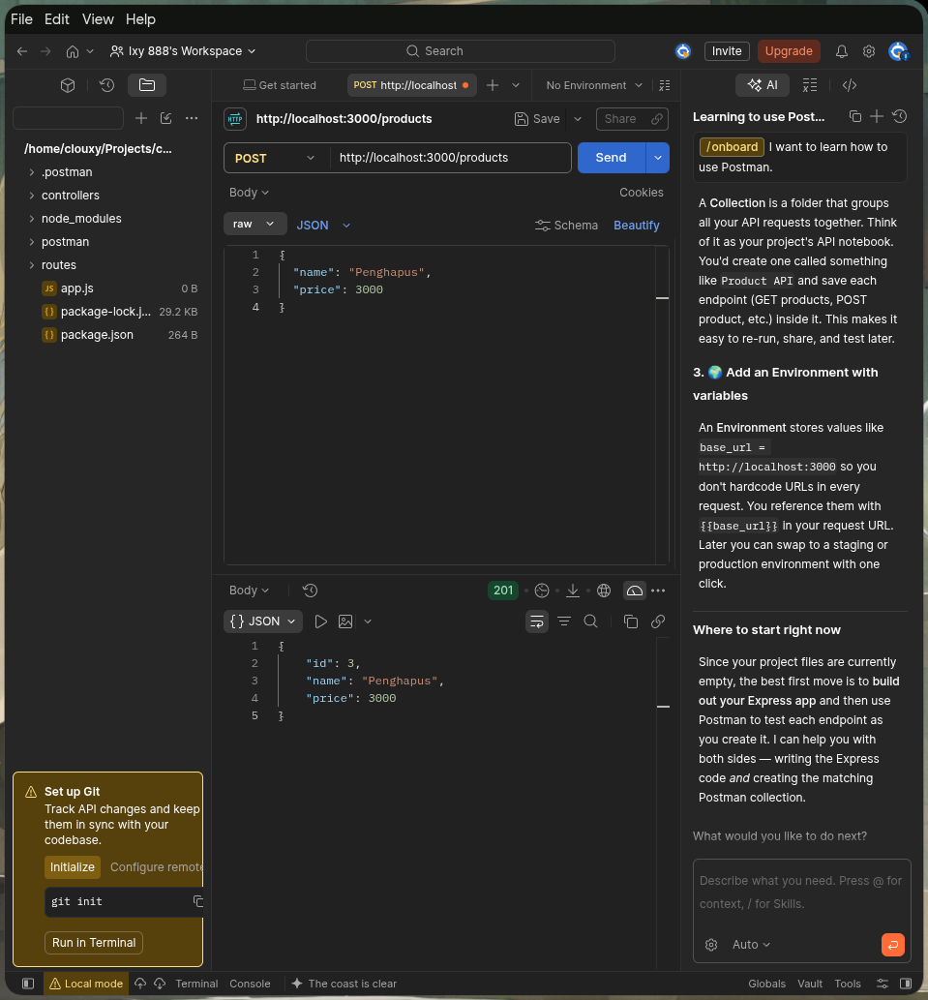

# Tugas: API Daftar Produk (ExpressJS)

REST API sederhana untuk mengelola daftar produk yang dibangun menggunakan **Express.js**. Data produk disimpan sementara di dalam memory (in-memory array).

---

## 📁 Struktur Proyek

```text
chall_expressjs/
├── controllers/
│   └── productController.js   # Logika bisnis dan penanganan request
├── data/
│   └── products.js            # Penyimpanan data awal (in-memory mock data)
├── routes/
│   └── productRoutes.js       # Definisi endpoint routing produk
├── screenshot/                # Bukti hasil pengujian API
│   ├── 1_get_all_products.png
│   ├── 2_get_product_id.png
│   ├── 3_get_404.png
│   └── 4_post_product.png
├── app.js                     # Entry point aplikasi Express
├── package.json               # Konfigurasi dependensi dan scripts
└── README.md                  # Dokumentasi proyek
```

---

## 🚀 Petunjuk Menjalankan

1. **Pastikan Node.js sudah terinstal** (versi 18+ disarankan).
2. **Buka terminal** di folder proyek ini.
3. **Instal dependensi:**
   ```bash
   npm install
   ```
4. **Jalankan server:**
   - Mode standar:
     ```bash
     npm start
     ```
   - Mode development (auto-reload):
     ```bash
     npm run dev
     ```
5. Server akan aktif di `http://localhost:3000`.

---

## 📌 Daftar Endpoint

| Method | Endpoint | Status Code | Deskripsi |
| :--- | :--- | :--- | :--- |
| **GET** | `/products` | `200 OK` | Mengambil seluruh data produk |
| **GET** | `/products/:id` | `200 OK` / `404 Not Found` | Mengambil detail produk berdasarkan ID |
| **POST** | `/products` | `201 Created` / `400 Bad Request` | Menambahkan produk baru ke dalam daftar |

---

## 🧪 Contoh Pengujian (cURL)

### 1. Mengambil Semua Produk
```bash
curl -i http://localhost:3000/products
```
**Response (200 OK):**
```json
[
  { "id": 1, "name": "Buku", "price": 15000 },
  { "id": 2, "name": "Pulpen", "price": 5000 }
]
```

### 2. Mengambil Produk Berdasarkan ID
```bash
curl -i http://localhost:3000/products/1
```
**Response (200 OK):**
```json
{ "id": 1, "name": "Buku", "price": 15000 }
```

### 3. Mengambil Produk yang Tidak Ada
```bash
curl -i http://localhost:3000/products/999
```
**Response (404 Not Found):**
```json
{ "message": "Produk tidak ditemukan" }
```

### 4. Menambahkan Produk Baru
```bash
curl -i -X POST http://localhost:3000/products \
  -H "Content-Type: application/json" \
  -d '{"name": "Pensil", "price": 3000}'
```
**Response (201 Created):**
```json
{ "id": 3, "name": "Pensil", "price": 3000 }
```

### 5. Validasi Input Cacat (Bad Request)
```bash
curl -i -X POST http://localhost:3000/products \
  -H "Content-Type: application/json" \
  -d '{"name": ""}'
```
**Response (400 Bad Request):**
```json
{ "message": "Nama dan harga produk wajib diisi" }
```

---

## 📸 Bukti Pengujian

### 1. GET `/products` (Semua Produk)


### 2. GET `/products/:id` (Produk Ditemukan)


### 3. GET `/products/:id` (Produk Tidak Ditemukan - 404)


### 4. POST `/products` (Tambah Produk - 201)

# express_product_api
